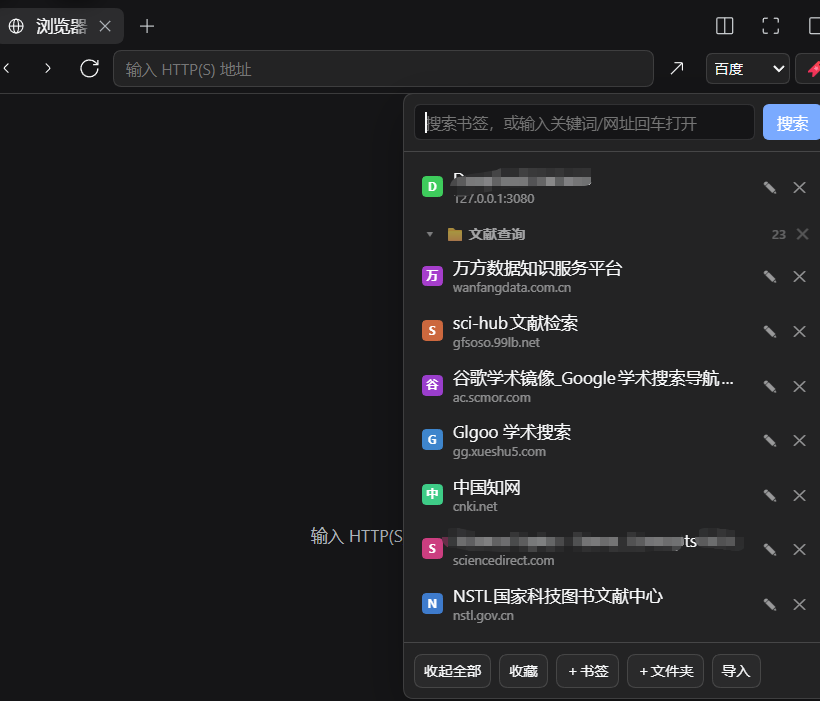
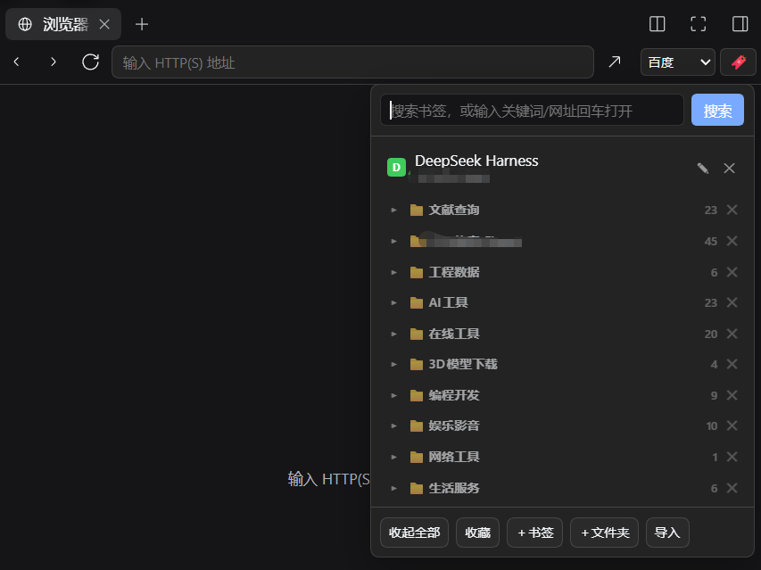
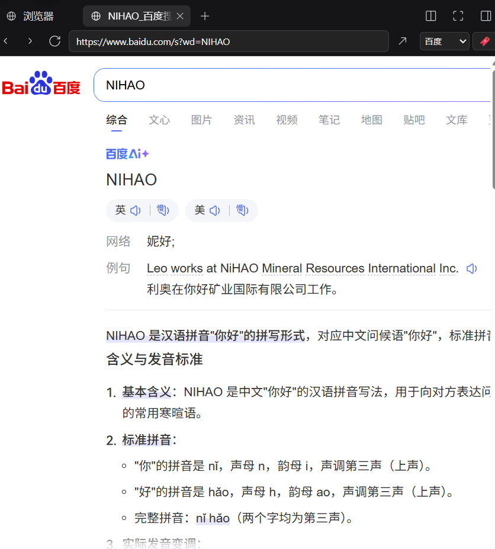
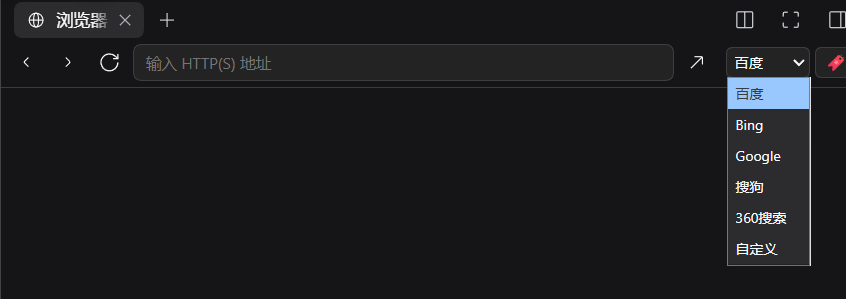

# 侧边栏浏览器搜索引擎以及书签功能补丁插件（dsh-browser-hub）

内置「浏览器」Tab 增强 —— the agent harness 桌面端右侧边栏**自带浏览器**的伴随插件。

> **English**: A companion plugin for the built-in **browser** tab in the desktop right sidebar: adds a search-engine dropdown (Baidu / Bing / Google / Sogou / 360 / custom), a bookmark button with a searchable panel, multi-level folders and 360/Chrome bookmark-HTML import, plus keyword-to-search behaviour in the address bar. Adapts DSH kernel 0.2.2-rc.1.

> 只增强**自带的「浏览器」Tab**，**不再单独新增标签页**（独立的「书签」Tab 与左侧边栏入口已移除）。

在自带浏览器工具栏右侧加入：

- 🔎 **搜索引擎下拉**：百度 / Bing / Google / 搜狗 / 360 搜索 / 自定义（`{q}` 占位）
- 🔖 **书签按钮**：点开面板可实时搜索书签、点开、＋收藏当前页、＋书签、＋文件夹、导入、编辑 / 删除

**地址栏增强**：在自带浏览器地址栏输入**非网址的关键词**（如「你好」）回车 → 用所选引擎搜索；输入真网址 / 域名则照常打开。

所有数据保存在本插件目录的 `data/store.json`，本地保存、不联网、不上传。

## 效果图

内置浏览器顶部工具栏右侧：搜索框、搜索按钮、搜索引擎下拉、书签按钮（红点提示收藏状态）。





在地址栏输入非网址的关键词（如 `NIHAO`）回车 → 用所选引擎搜索并直接在当前标签打开：





## 快速上手（5 步）

1. **打开**：装好并重启 DSH 后，点右侧边栏里自带的「浏览器」Tab —— 插件增强的就是这个 Tab，不会多出新标签页。
2. **收藏**：点工具栏 **🔖** 打开书签面板 → 「＋书签」填名称与网址；「＋文件夹」建多级目录，面板里可移动 / 编辑 / 删除。
3. **搜索**：在地址栏输入**非网址的关键词**回车 → 用下拉所选的搜索引擎在当前标签打开；输入真网址或域名则照常打开。
4. **换引擎**：工具栏下拉选 百度 / Bing / Google / 搜狗 / 360；要别的选「自定义」，在旁边的输入框里写模板，`{q}` 就是关键词占位（例：`https://example.com/search?q={q}`）。
5. **迁移与更新**：已有收藏点「导入书签」→ 粘贴 360 / Chrome / Edge 导出的书签 HTML 内容即可整批进来；点 **⟳** 检查更新（见下节），有新版装完需彻底退出 DSH 再启动。

## 版本提醒（⟳ 检查更新）

工具栏（＋书签 / ＋文件夹 / 导入书签）后面有一枚 **⟳**，点一下即查 npm 上本插件的最新版本：

| 状态 | 表现 |
|---|---|
| 检查中 | 按钮变 ⏳，悬浮提示「检查中…」 |
| 有新版本 | 按钮变色，悬浮提示「有新版本 vX（当前 vY），点一下更新」，面板底部同步提示 |
| 已是最新 | 恢复默认外观，绿字提示「已是最新 vX」 |
| 检查失败 | 红字提示失败原因（`HTTP 404` 会显示「接口不可用（宿主未重启？）」） |

- 处于「有新版本」时**再点一下** → 一键装进当前 desktop profile → 成功后提示「已更新到 vX，**请彻底退出 DSH 重启**」。必须彻底退出客户端再启动：宿主端文件不会热重载，`Ctrl+Shift+R` 只重载客户端。
- 本按钮复用技能浏览器的全局更新委托 `window.__dshUpdClick`，因此四态提示与红点规则和其它插件完全一致；本插件只贡献自己的按钮与包名（`data-dsh-upd="dsh-browser-hub"`）。

## 安装（桌面端 desktop profile）

> 桌面 profile 由 Electron 独占管理，只能用「手改 package.json + pnpm install」的方式装。

1. 把本目录放到 `~/.dsh/local-plugins/dsh-browser-hub`。
2. 编辑 `~/.dsh/profiles/desktop/package.json`：
   - `dependencies` 增加：
     ```json
     "dsh-browser-hub": "0.2.8"
     ```
   - `dsh.profile.bundles` 数组增加 `"dsh-browser-hub"`。
3. 在 `~/.dsh/profiles/desktop` 目录执行 `pnpm install`。
4. **完全退出 the agent harness 再启动**（宿主无热重载）。

## 说明

- 打开网页走宿主原生浏览器：`ctx.get('sidebarRight').openTab('browser', { params: { url } })`。
  插件无法把 Edge / 360 内核塞进侧边栏（桌面端封死了 iframe / webview），这是平台限制。
- 增强通过**运行时 DOM 注入**实现（不动 `app.asar`），锚点用 CSS 语义后缀 `[class*="_toolbar"]` + `input[class*="_address"]`；
  若 the agent harness 大版本改了内置浏览器 UI 结构，可能需要重调锚点。
- 改动 `lib/client.js` 后用 **Ctrl+Shift+R** 硬刷新即可生效（无需完全重启）。

## 版本

- 0.2.7 工具栏（＋书签 / ＋文件夹 / 导入书签）后面新增 **⟳ 检查更新**：点一下查 npm 最新版，有新版变蓝显示「更新到 vX」，再点一下即一键装进 desktop profile；复用技能浏览器的全局更新委托 `window.__dshUpdClick`。纯客户端改动，**Ctrl+Shift+R** 硬刷新生效。
- 0.2.6 修复「启动正常但侧边栏功能失效」：上一版用 setInterval 轮询后重入 apply，而 apply 已在 fiber 激活完成后才调用，注册被**静默吞掉**；现改用 cordis 官方响应式注入 `ctx.inject(["betterSidebar"], cb)`，服务就绪时自行执行注册。
- 0.2.5 启动稳定性：服务从 declared inject 移除（避免 pending 卡住 web boot），改为安全取值器 `__safeSvc` + 最多 30s 轮询。
- 0.2.4 框架缓存修复：betterSidebar 改为**软等待**（最多 30s），不再因服务晚就绪而卡住 web boot。
- 0.2.3 新增 `screenshots.json` 与 4 张效果图（`docs/screenshots/`），插件市场卡片与详情页可显示配图；README 补英文段与效果图区；`files` 白名单纳入 `docs` 与 `screenshots.json`，npm 包同步携带配图。
- 0.2.2 新增 locale 元数据（市场显示名/描述）。
- 0.2.1 修复删除 ✕ 无效（删除/新增/移动改用树根解包，传整库对象也能操作）；新增「收起全部 / 展开全部」一键折叠；脱敏后发布。
- 0.2.0 移除独立「书签」Tab 与侧栏入口；改为纯内置浏览器增强（工具栏注入 + 地址栏搜索 + 面板内管理/导入）。
- 0.1.0 首版：搜索引擎 + 书签收藏 + 多级文件夹（拖拽）+ 导入书签 HTML。

MIT License.
